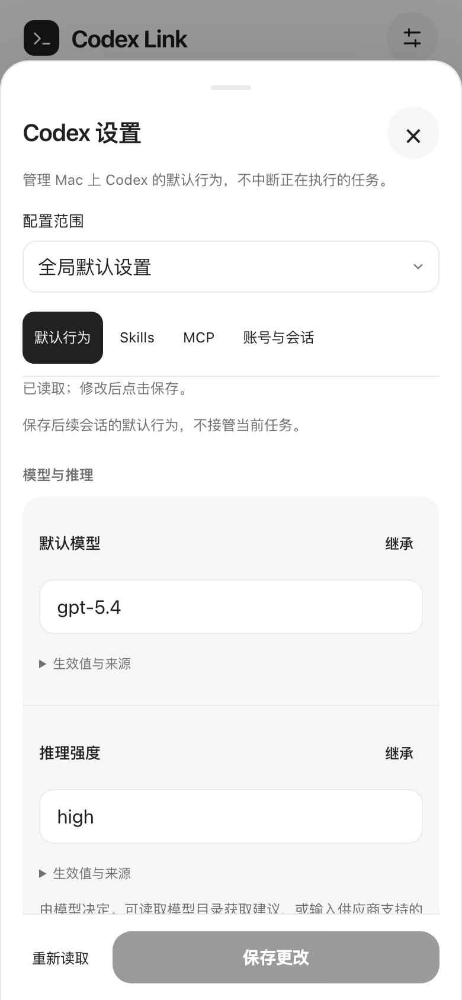

# Codex 设置接入

## 入口与作用范围

- 工作空间底部 **Codex 设置**，或 **界面设置 → Codex 默认行为、Skills 与 MCP**。
- 已登记的本机项目菜单有 **Codex 项目配置（只读）**；也可在设置顶部切换范围。未登记的历史目录先添加为项目，SSH 项目暂不支持。
- **界面设置**只负责外观；**Codex 设置**读取 Mac 上真实的 Codex 配置，不是手机本地模拟开关。
- 本文介绍 Mac 网关和网页提供的全局／项目配置页。**重启 Mac 网关、刷新 iOS 页面即可；不用重装 IPA 或重新配对。** 刷新前保存未发送草稿。iOS 原生会话的模型与推理强度面板另见 [原生 iOS 说明](native-ios.md#原生实现)。



## 已接入

| 功能 | 接口 | 当前行为 |
| --- | --- | --- |
| 配置与来源 | `config/read` | 读取有效值、用户覆盖值、来源及配置层 |
| 全局默认值保存 | `config/batchWrite` | 带 `expectedVersion` 写用户配置，随后启动新查询回读验证 |
| 管理员限制 | `configRequirements/read` | 限制可选的审批、沙盒与搜索策略；不能确认限制时不允许写入 |
| 模型目录 | `model/list` | 按需读取；自定义服务可手动输入模型 ID |
| 技能列表和开关 | `skills/list`、`skills/config/write` | 按目录列出技能；确认后写用户级开关，并回读状态 |
| MCP 状态 | `mcpServerStatus/list` | 用户点按钮后查询，只显示名称、认证状态、工具数量和发现错误标记 |
| 账号与接入 | 原有账号面板 | 复用已有流程，不重复保存密钥 |
| 当前会话模型 | 原有桌面连接与模型面板 | 不经新查询进程恢复或接管会话；只读历史不可用 |

可编辑全局字段：

- `model`：默认模型。
- `model_reasoning_effort`：推理强度。
- `model_reasoning_summary`：推理摘要。
- `model_verbosity`：回答详略。
- `web_search`：联网搜索模式。
- `approval_policy`：审批策略。
- `sandbox_mode`：执行沙盒。
- `developer_instructions`：开发者指令。

表单只提交实际改动的字段。**继承**或者清空输入框会在保存时以 `null` 移除该用户级覆盖，不是强制写入某个默认值；其他 TOML 配置由原生接口保留。

此页的默认推理强度写入用户级 `model_reasoning_effort` 配置。0.160.0 将其表示为模型相关字符串；配置页可读取目录建议或手动输入。原生会话面板则根据当前模型目录提供的强度选项显示下拉菜单。配置被保存或会话参数被提交，不代表模型服务已验证该组合可成功推理。

## 全局可写，项目只读的原因

在本机 `codex-cli 0.160.0` 的**空临时 HOME**中实际验证：

1. 用户配置 `config.toml` 可读写、可清除覆盖，并支持版本校验。
2. 已信任项目的 `.codex/config.toml` 会出现在配置层中，参与有效值计算。
3. 尽管 `config/batchWrite` 参数里有 `filePath`，写项目配置实际被拒绝：

```json
{
  "code": -32600,
  "data": {"config_write_error_code": "configLayerReadonly"},
  "message": "Only writes to the user config are allowed"
}
```

因此，本轮**只通过原生接口保存用户配置**。项目页显示生效值和来源，不开放伪保存、不直接改写项目 TOML 绕过限制。项目未被信任、某层被禁用或用户配置被更高层覆盖时，以原生读取结果为准。

codex-link 自身的项目登记仍在 `.local/workspace.json`，没有悄悄迁移到实验性 `project/create` 等接口。

[查看项目只读配置预览](images/settings-project.png)（合成数据）。

## 生效与失败提示

- 保存针对**之后加载配置的会话**。不热更新、不停止、不接管桌面正在执行的任务。桌面端可能仍需重新加载配置，以 Mac 新会话实际加载的值为准。
- 查询进程写入时不要求重载用户配置；随后由另一个查询进程回读文件，避免只验证旧进程缓存。
- 每次读取返回一个有效期 15 分钟、绑定范围的临时版本凭据。保存前重新读取并比较配置层版本和限制，再将原生用户层版本交给写接口。
- 版本冲突不会自动覆盖；超时或回读失败会提示**结果未确认**，不能宣称没写入，也不自动重试。
- 保存失败保留页面草稿。重新读取、关闭页面或切换范围时，对未保存内容进行确认；页面刷新不承诺保留草稿。
- 保存成功但生效值不同，会提示被更高优先级配置覆盖；展开每项的 **生效值与来源** 检查。
- 修改沙盒或审批策略必须再次确认，包括选择“继承”。
- profile、命名权限方案、结构化高级设置、符号链接配置或不兼容协议等情况会显示只读原因，不擅自展平覆盖。

### Skills 的额外边界

按项目列出的技能，开关仍写入**全局用户配置**，不是项目专属设置。不会卸载当前任务已经加载的技能。

技能写接口没有原生 `expectedVersion` 参数。本实现会校验先前读取的配置版本与技能列表，再写入并回读，但**不能保证跨进程原子 CAS**。其他客户端恰好同时修改时仍有竞争窗口。仅允许操作当前原生列表中出现的技能路径，不能传任意路径。

### MCP 的额外边界

这里是**设置查询进程**看到的 MCP 状态，不代表桌面正在执行的会话。读取可能启动或连接配置的 MCP 服务，但不会调用 MCP 工具，也没有集成 OAuth 登录、写入服务器配置或重载桌面 MCP。

## 安全与实现

- `mac/settings_rpc.py`：按需启动短生命周期 stdio app-server；协议探测在临时空 HOME 中完成；RPC 方法白名单、超时、响应长度和队列上限，进程退出清理。
- `mac/settings.py`：配置白名单、版本凭据、管理员限制、权限确认、回读和安全摘要。
- `mac/settings_http.py`：复用认证、Host／Origin／CSRF 检查；没有通用 JSON-RPC 转发入口。
- `web/link-settings.js` / `.css`：独立设置界面；原 `link-ui.js` 继续只负责表现层。

HTTP 接口：

```text
GET  /api/codex-settings?scope=<已登记项目键，可省略>
POST /api/codex-settings
     {scope, revision, changes, confirmPermissions}
GET  /api/codex-settings/models
GET  /api/codex-settings/skills?scope=<项目键，可省略>
POST /api/codex-settings/skills
     {scope, revision, path, enabled, confirmed}
GET  /api/codex-settings/mcp
```

不会把完整配置、完整 layer config、provider 定义、环境变量、MCP 工具定义或原始 RPC 错误返回手机。允许显示的开发者指令属于用户主动管理的正文，请勿把敏感内容放进截图或问题反馈。

配对流程、Bundle ID、Keychain、`.local/` 和上游 vendor 快照没有因本功能改变。没有集成 AGENTS.md 编辑、记忆重置、任意 TOML 编辑或实验性会话设置接管。

## 验证与验收

自动化命令：

```sh
python3 -m unittest discover -s tests -v
python3 scripts/test-standalone.py
node scripts/test-web-ui.cjs
UI_BROWSER=webkit node scripts/test-web-ui.cjs
bash scripts/test-ios-smoke.sh
# 可选：使用安装的运行时，但仅操作一次性合成 HOME
python3 scripts/test-settings-native.py
```

- Python 全量测试以当前工作区测试结果为准；设置相关用例覆盖配置读写、清除覆盖、冲突／过期／范围绑定、只读和限制、敏感字段过滤、技能确认、认证／CSRF 与传输错误。
- Chromium / WebKit 合成 API：保存回读、冲突保留草稿、权限确认和取消、模型建议、技能开关、MCP、项目只读，以及 320–1280px 布局。
- 一次性 iOS 模拟器：IPv4／IPv6 回环、证书绑定、WKWebView 认证和新增设置资源加载；不等于真机真实配置操作已通过。
- 实际 0.160.0 的隔离测试：读写／清除／回读、原生版本冲突、项目层有效值及项目写入拒绝、技能禁用回读。没有模型调用、桌面 IPC 或真实账号访问。

真机验收建议：先读取、查看来源；自行确认后改一个无权限影响的默认项并保存，再点继承恢复。最后才测试权限和技能开关。自动化验证使用合成配置或一次性 HOME，不应据此推断真实账号、生产网关或真机安装已验收。
