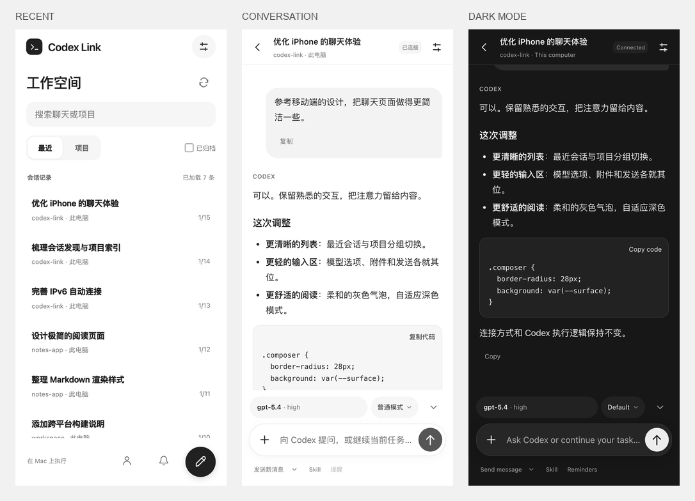

# 移动端 UI 改造

> 后续已补齐项目与会话操作：新建项目／目录浏览、项目内新建对话、独立菜单、排序、多选、归档及隐藏恢复。见 [项目与对话操作说明](workspace-actions.md)。下面的预览是早期视觉改版截图，不包含所有新入口。

## 设计方向

参考本地 `codex-mobile` Android Compose 项目的视觉设计，在 codex-link 中独立实现，不复制其执行逻辑，也不依赖它的目录、构建工具或资源。

主要参考位置（均为参考项目内路径）：

- `ui/theme/CodexPalette.kt`：白色底、浅灰层级、深色文字。
- `feature/shell/HomeScreen.kt`、`ThreadListScreen.kt`：简洁项目卡片、会话行、圆形新建入口。
- `feature/conversation/ComposerComponents.kt`：模型胶囊、圆角输入容器、附件加号及圆形发送按钮。

上面路径的共同前缀为 `app/src/main/java/com/hoto/codexmobile/`。

## 预览

下图是 **Chromium 中的模拟会话**，不是实际用户聊天，也不是 iPhone 真机截图。依次为最近会话、聊天和深色聊天界面；原生状态栏及连接栏不在截图范围内。



## 已实现的变化

| 区域 | 调整 |
| --- | --- |
| 工作空间 | 品牌栏、搜索、最近／项目切换、已加载／总数量、来源与内部会话筛选、圆形新建入口 |
| 项目分组 | 完整项目索引及数量、点击进入该项目的分页会话列表 |
| 聊天 | 简洁标题栏、项目副标题、浅灰用户气泡、圆角代码块；回复不显示 CODEX 标识，实时与只读历史均不展示思考摘要 |
| 执行过程 | 消息之间连续的工具调用、输出、文件读取与写入合并为一行「执行过程 · N 项」，默认收起，点击后查看；与相邻消息的间距收紧，实时更新保留手动展开状态 |
| 输入区 | 模型／工作模式胶囊、附件加号；任务执行中且无草稿时只显示停止按钮，有文字或附件时只显示发送按钮，空闲且无草稿时显示灰色禁用发送按钮；次要选项置于下方 |
| 设置 | 手机底部面板；主题、语言与阅读选项优先；「对话内容 → 复制按钮」可隐藏消息下方的复制按钮，偏好保存在当前浏览器，通知等放入更多设置 |
| iOS 原生壳 | 整条可点击的连接状态栏，重连／刷新入口收进连接设置，重做未连接引导页 |
| 适配 | 浅色／深色、窄屏／桌面、可见视口变化、减少动态效果偏好 |

原有发送、排队、补充当前任务、停止、审批、模型、Skill、附件、草稿和新建会话仍沿用上游处理逻辑。发送按钮的可访问名称保留原有动态文案，而非仅有一个没有说明的箭头。

**后续读取改造已接入：** 项目页现在基于完整的筛选结果计算分组和数量，不受前 100 条限制；最近页显示已加载／总数。新增来源筛选、只读历史提示及刷新按钮，详情可切换桌面会话的只读日志视图。行为与限制见 [对话发现与历史读取](history-reading.md)；上方预览仍为最初视觉改版的合成截图。

## 工程实现

- `mac/web_ui.py` 在原页面末尾加载同源的 `web/link-ui.css` 和 `web/link-ui.js`。
- JS 移动、装饰已有 DOM 节点，保留现有表单和事件处理器；新页签驱动原来的显示方式控件。已移除思考摘要的显示开关。
- `web/link-presentation.js` 替代上游外观脚本，忽略旧版的摘要显示偏好；`web/link-timeline.js` 在聊天控制器之前加载，跳过实时摘要并沿原分页游标读取正文。只读历史在读取器中直接省略摘要记录。
- 执行过程的灰色标题、箭头和缩进布局参考本地 `Codex_App_Rebuild/fork` 的对话页及 `tool-activity-disclosure` 组件，在本项目独立实现。工具记录按消息和任务边界分组；只在用户点击正文展开按钮时读取完整输出，错误与待确认请求保持直接可见。
- 展示层不自行请求 Codex API，不恢复或创建额外的会话执行进程。
- 后续独立功能层 `web/link-history.js` / `.css` 在展示层之后加载，负责读取接口、完整项目索引及只读控制；不把接口逻辑塞进纯展示脚本。
- `web/link-workspace.js` / `.css` 再接入管理流程；筛选收进可展开面板，项目／会话操作由独立「···」按钮提供，不依赖悬停。
- `vendor/codex-mobile-bridge/` 快照及其哈希不变；资源、字体与依赖仍完全本地提供。
- 新资源沿用 Host／Origin 校验、CSP、`no-store` 等响应策略；没有放宽认证、CSRF 或设备配对要求。
- iOS Bundle ID、Keychain 标识及设备协议不变。

## 如何看到新版

1. 保留 `.local/`，正常停止旧 Mac 网关，再重新运行 `启动Mac网关.command`。第一次启用新资源路由需要重启 Python 进程。
2. 在 iOS 连接设置里刷新聊天页面。**刷新前请保存未发送草稿。** 仅查看网页新 UI 不需要重装 iOS App。
3. 如需新的原生连接栏和引导页，使用 TrollStore 覆盖安装 `build/codex-link-0.1.0-TrollStore.ipa`，不要先卸载、忘记 Mac 或删除配对数据。

本次开发没有自动重启用户正在运行的网关，也没有自动安装手机 App。

## 验证

- 最初 UI 改版 Python 回归为 27 项；后续读取改造的测试与限制见 [读取说明](history-reading.md#验证范围)。
- Chromium、WebKit：模拟 API 下的原始节点完整性、列表／项目切换、搜索／归档、超过 100 条分页、草稿、发送失败重试及幂等键、停止、审批／离线展示、附件选择器、模型／Skill、新建弹窗、英文／深色模式通过。
- 覆盖 320、375、390、430、768、1280 宽度，以及缩短可见视口的布局检查。
- iOS arm64 Release 构建、TrollStore ad-hoc 签名检查通过。
- 一次性 iOS 模拟器：Keychain、证书绑定、错误证书拒绝，以及 IPv4／IPv6 回环下 WKWebView 认证和新界面加载通过。

浏览器测试复现方式（Playwright **仅用于开发测试，不是运行依赖**）：

```sh
npm install --prefix build/ui-testing --no-save --no-package-lock playwright@1.56.1
node build/ui-testing/node_modules/playwright/cli.js install chromium webkit
node scripts/test-web-ui.cjs
UI_BROWSER=webkit node scripts/test-web-ui.cjs
```

所有请求均被测试夹具截获，仅使用合成数据，不访问真实网关或 Codex。Chromium 截图输出到 `build/ui-preview/`。

当前 macOS 13 上的 Playwright WebKit 为冻结版本；它的截图准备代码会注入内联样式，被现有 CSP 拒绝。因此 WebKit 跑交互与布局回归但跳过截图，没有为测试打开 `bypassCSP` 或放宽生产安全策略。

**仍需真机验收：** TrollStore 覆盖安装、真实 iOS 键盘／安全区／横竖屏、VoiceOver，以及真实 Codex 的发送、停止和审批。模拟视口变化不等于真机键盘测试，构建通过也不等于全部功能已完成真机验证。

## Codex 设置面板

新增独立的真实设置面板，与外观设置分开。采用同一套黑白灰卡片和移动端底部面板，提供默认行为、Skills、MCP、账号与会话入口。配置范围、来源、只读原因、保存回读结果和冲突提示都可见。详情见 [Codex 设置接入](codex-settings.md)。
