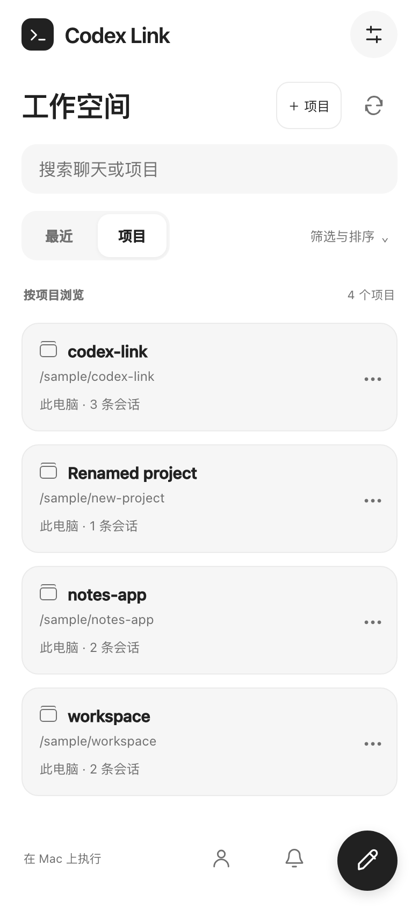
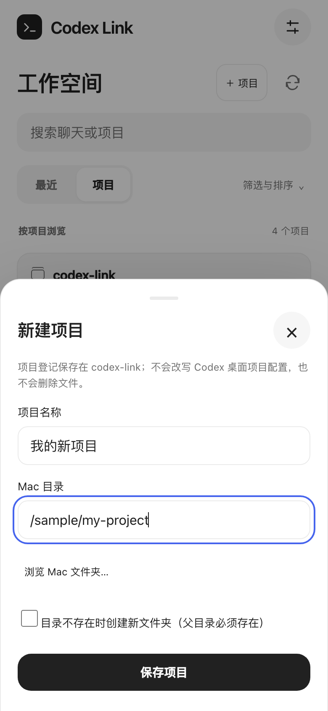

# 项目与对话操作补全

上一版主要做了视觉调整和历史阅读，项目卡片、会话列表缺少独立操作入口。此次以参考 `codex-mobile` 的首页、项目对话列表、目录选择和菜单流程为依据，补上实际后端与持久化，**不是搬入示例数据或模拟成功按钮**。

参考目录现在位于本项目旁边的 `codex-mobile/`。其 README 明确说明它是纯 UI 演示：项目、归档等状态在内存中，目录选择也是示例。本项目保留交互思路，独立实现真实网关接口，不依赖该目录。

## 界面预览

以下为 Chromium 中的合成数据截图，不是用户项目，也不是 iPhone 真机截图。

| 项目与操作入口 | 新建项目 |
| --- | --- |
|  |  |

## 使用入口

| 位置 | 现在可以做什么 |
| --- | --- |
| 工作空间标题旁 **「＋ 项目」** | 新建项目登记：填名称、选择 Mac 现有目录，或明确勾选创建新文件夹 |
| 新建对话窗口 **「＋ 新建项目」** | 没有项目时可直接添加；保存后返回新建对话流程 |
| 项目卡片 **「···」** | 在该项目新建对话、修改显示名称、查看 AGENTS.md、隐藏／恢复、复制目录 |
| 历史目录分组 **「···」** | 添加为项目，再在该目录创建对话；不会假设所有历史 cwd 都是已登记项目 |
| 项目内部 | 显示名称与完整路径，提供该项目的新建对话和菜单；新建时自动选择当前项目 |
| 会话行或聊天顶栏 **「···」** | 打开、只读查看日志、置顶／取消、修改名称、归档／取消归档、隐藏／恢复、复制 ID，按能力显示 |
| **「筛选与排序」** | 来源、内部／归档会话、标题／最近更新时间排序、正常／已隐藏列表和多选 |
| 多选工具条 | 选择已加载的最多 100 条，批量置顶、隐藏／恢复、归档／取消归档、退出多选 |

菜单不依赖鼠标悬停，触屏可直接点「···」；项目和会话也提供上下文菜单事件。筛选放在可展开面板内，不再长期挤占列表。修复语言切换时图标被长文本替换、与新建按钮挤在一起的问题。

## 新建项目究竟做了什么

1. 项目登记保存于网关数据目录的 **`workspace.json`**，默认为 `.local/workspace.json`，重启后保留，多个已配对设备共用。
2. 目录选择器浏览的是 **Mac 目录**，不是 iPhone 文件。只列出非隐藏、非符号链接的子目录，支持路径输入、名称筛选和每页 100 个子目录。
3. 默认只添加已有目录。勾选“创建新文件夹”后才调用文件系统创建**一个新目录**，父目录必须存在；不会递归创建一整串路径，不覆盖已有文件。
4. 空项目也会出现在项目列表，不再必须先有一条对话才能看见。
5. 新项目会进入 `/api/projects` 的可选集合，原有幂等新建对话逻辑通过该目录创建真实 Codex 会话，再交给桌面。不会另写一套消息执行引擎。

**项目登记是 codex-link 的工作空间管理，不是修改 Codex Desktop 的项目配置。** 它不会直接改写 `.codex-global-state.json`。桌面应用如何按 cwd 展示新建会话，取决于其版本，不能承诺新项目卡片立即同步出现在桌面首页。

同目录不能重复添加；同一次创建请求的重试不会重复登记。若创建文件夹后保存登记失败，文件夹可能已经存在，**不会为了回滚而自动删除它**，应检查后重试。

## 哪些操作修改原始 Codex 数据

| 操作 | 作用范围 |
| --- | --- |
| 项目登记、显示名称、隐藏／恢复 | 仅 `workspace.json`；不修改桌面项目配置，不删目录 |
| 会话置顶、隐藏／恢复 | 仅 `workspace.json`；不修改日志、数据库标题或归档状态 |
| 会话重命名 | 原上游的 Codex `thread/name/set` 链路，仅符合桌面来源范围的会话 |
| 会话归档／取消归档 | 新接入 Codex `thread/archive` / `thread/unarchive`，仅本机桌面会话，不直接 SQL 更新 |
| AGENTS.md | 只读显示已登记本机项目根目录的文件，最多 256 KiB；拒绝符号链接和非普通文件，不提供编辑保存 |

**没有提供永久删除原始会话、递归删除项目文件、移动原始日志的按钮。** “隐藏”明确叫隐藏，可恢复，不能把它描述为真正的删除或归档。隐藏项目不会自动隐藏最近列表中的所有对话；项目隐藏和会话隐藏是独立选项。

### 归档的保护与限制

- 需要在确认窗口显式确认；不因浏览列表或打开菜单而归档。
- 使用短生命周期 app-server 发出指定的归档 RPC，不发 `turn/start`、`thread/resume` 或停止任务请求。
- 保留原桌面来源校验、账号切换锁和会话操作锁；发现本机已知的执行中／待审批／待发送／结果不明状态时拒绝操作。**这不是对桌面实时状态的绝对保证**，请先确认任务结束。
- CLI 等只读历史不能借归档接口获得写能力。SSH 的归档暂未接入，可用本地列表“隐藏”整理。
- 批量归档逐条执行；失败时显示已确认数量并刷新，停止处理剩余项，不假装全部成功，也不会自动重试未确认请求。
- Codex 版本不支持相应 RPC、运行时退出异常或超时会显示错误；真实桌面归档仍需用专门测试会话验收。

## 工程与安全边界

- `mac/workspace.py`：持久项目登记、显示偏好、目录浏览、AGENTS.md 只读。
- `mac/workspace_http.py`：`/api/workspace/projects`、`preferences`、`archive`、`directories`、`agents`；所有接口需要设备认证，写操作需要原同源与 CSRF 校验。
- `ProjectHosts` 将登记目录提供给原 `Bridge.create_chat()`；上游快照不变。
- `history_catalog.py` 将空项目、项目显示名称、会话置顶／隐藏和排序接入完整索引，排序／筛选发生在分页之前。
- `web/link-workspace.js` / `.css` 提供交互；纯展示脚本、读取层与管理层分开。
- `workspace.json` 原子替换并使用 `0600` 权限。备份时随 `.local/` 一起保留，不上传公开仓库。

配对、Bonjour、IPv4／IPv6、证书与 Keychain 身份没有改变。

## 测试与尚未验证的范围

- 该功能阶段的历史基线为后端／资源 **66 项测试通过**；当前全量测试结果见仓库根目录 [验证记录](../VERIFICATION.md#当前工作区快照2026-11-05)。
- 新增覆盖：登记持久化与幂等、重复路径、显式目录创建、空项目、完整索引／排序、隐藏恢复不删文件、目录分页、AGENTS.md 读取边界、归档 RPC 白名单、认证／CSRF、批量校验及只读能力边界。
- Chromium／WebKit：新建失败保留输入、浏览目录、新建项目、改名、隐藏恢复、指定项目中新建对话、会话改名／置顶／归档恢复、多选整理、只读限制、迟到资源初始化、窄屏与主题语言回归通过。
- iOS 一次性模拟器：新项目／会话操作入口加载，以及 Keychain、证书固定、IPv4／IPv6 回环认证通过。

测试只使用合成数据、临时目录、假 Codex 与回环监听。**没有修改用户的真实项目、会话或 `~/.codex`；没有运行真实归档、创建真实 Codex 对话，也没有声称已完成真机端到端验收。**

## 如何生效

保存手机未发送的草稿，正常停止旧 Mac 网关并重新启动，再刷新 iOS 网页。此次无需重新构建／安装 IPA，也无需重新配对。开发过程中没有自动重启现有网关、安装手机或提交／推送代码。
